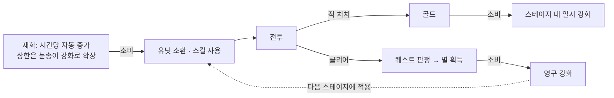
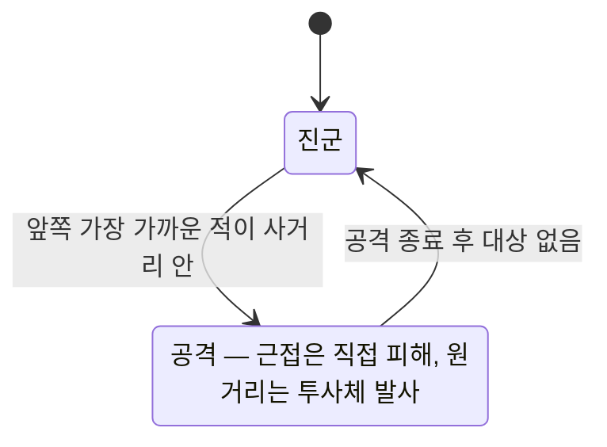

# 악마는 저리가 (Karma Defence) — 기술 문서

[← README로 돌아가기](../README.ko.md)

## 목차

1. [개요](#1-개요)
2. [핵심 설계 ① 다종 유닛 오브젝트 풀링](#2-핵심-설계--다종-유닛-오브젝트-풀링)
3. [핵심 설계 ② 퀘스트와 별 경제](#3-핵심-설계--퀘스트와-별-경제)
4. [핵심 설계 ③ 두 계층의 강화](#4-핵심-설계--두-계층의-강화)
5. [유닛 전투 AI](#5-유닛-전투-ai)
6. [개발 편의 도구](#6-개발-편의-도구)
7. [그 외 구현](#7-그-외-구현)
8. [한계와 개선 방향](#8-한계와-개선-방향)

---

## 1. 개요

| 항목 | 내용 |
|---|---|
| 장르 | 라인 디펜스 (Android) |
| 개발 | 팀 프로젝트, 프로그래밍 전체 담당 |
| 기간 | 2020.07 ~ 2021.03 |
| 링크 | [시연 영상](https://www.youtube.com/watch?v=o5AaV3zBt2k) · [Google Play](https://play.google.com/store/apps/details?id=com.nineteengames.karmadefence&hl=en_US&gl=US) (서비스 종료) |

천사 진영과 악마 진영의 유닛이 한 줄의 전장에서 서로를 향해 진군합니다. 플레이어는 대천사를 좌우로 움직이며 유닛을 소환하고 스킬을 씁니다. 보스(드래곤)를 쓰러뜨리면 승리하고, 아군 석상이 무너지면 패배합니다.



한 스테이지 안에서는 **재화(소환·스킬)**와 **골드(일시 강화)**를 쓰고, 스테이지 사이에는 **별(영구 강화)**이 이어집니다. 세 자원이 서로 다른 시간 단위로 순환하도록 설계했습니다.

---

## 2. 핵심 설계 ① 다종 유닛 오브젝트 풀링

전투 중 유닛이 끊임없이 생성·소멸되므로 `Instantiate/Destroy` 대신 풀링을 썼습니다. 유닛 종류가 여러 개라 종류마다 풀을 따로 두는 대신, **한 부모 아래에 종류를 번갈아 배치**하는 구조를 택했습니다.

### 배치와 탐색

```
부모(SpawnPos)의 자식 순서 — 유닛 3종, 풀 크기 2인 경우

인덱스:  0    1    2    3    4    5
종류:   검사  궁수  마법사 검사  궁수  마법사
        └──── 1회차 ────┘└──── 2회차 ────┘
```

```csharp
// 초기화: 회차마다 모든 종류를 한 번씩 생성 → 종류가 번갈아 배치됨
for (int i = 0; i < spawnCt; i++)
    for (int j = 0; j < obj.Length; j++)
        Instantiate(obj[j], ...).transform.parent = tr;

// 소환: 해당 종류의 인덱스에서 시작해 종류 수만큼 건너뛰며 비활성 슬롯 탐색
for (int i = 0; i < Units.Length * spawnCt; i += Units.Length)
{
    if (i < idx) { i = idx; }
    var spawnObj = SpawnPos.transform.GetChild(i).gameObject;
    if (!spawnObj.activeSelf) { spawnObj.SetActive(true); ...; break; }
    else if (i + Units.Length >= Units.Length * spawnCt)
    {
        spawnCt += spawnCt;          // 풀이 부족하면 두 배로 확장
        PoolSpawn(Units, SpawnPos);  // 회차 단위로 추가 → 번갈아 배치 규칙 유지
    }
}
```

- **같은 종류만 확인**: 시작 인덱스가 곧 종류 번호이고 보폭이 종류 수라서, 다른 종류의 슬롯은 건너뜁니다.
- **확장 후에도 규칙 유지**: 확장은 항상 "모든 종류 한 번씩" 단위로 뒤에 붙이므로, 인덱스 공식이 그대로 성립합니다.

### 스폰 간격 테이블

적 진영은 자동으로 유닛을 소환합니다. 유닛 종류 × 스테이지마다 간격이 다른데, 이를 **1차원 배열 하나**로 관리합니다.

```csharp
spawnTime[spawnTime.Length / Units.Length * 종류 + (현재 스테이지 - 1)]
```

배열을 종류 수만큼 구간으로 나눠, 각 구간이 그 종류의 스테이지별 간격이 됩니다. 인스펙터에서 배열 하나만 편집하면 됩니다.

### 다른 풀링

| 대상 | 방식 |
|---|---|
| 원거리 투사체 | 유닛 자신의 자식으로 보관. 비활성 투사체를 재사용하고, 없으면 생성해 자식에 추가 |
| 보호막 스킬 | 아군 최대 수만큼 미리 생성 |
| 빛의 비·폭발 스킬 | 1개로 시작해, 모두 사용 중이면 하나씩 추가 |

**관련 코드**: [`UnitSpawn.cs`](../Common/Unit/UnitSpawn.cs), [`Unit.cs`](../Common/Unit/Unit.cs), [`SkillMgr.cs`](../Manager/SkillMgr.cs)

---

## 3. 핵심 설계 ② 퀘스트와 별 경제

스테이지마다 최대 3개의 퀘스트가 있고, 달성한 퀘스트마다 별 1개를 얻습니다. 별은 영구 강화(4장)의 재화입니다.

### 퀘스트 종류

| 종류 | 집계 |
|---|---|
| Clear | 스테이지 클리어 |
| Spawn | 아군 유닛 소환 수 |
| Kill / KillbySkill / KillbySword / KillbyBow | 처치 수 (전체 / 스킬 / 전사 / 궁수) |
| BossHitbySkill | 보스에게 스킬 적중 |
| Reinforce | 스테이지 내 강화 횟수 |
| SaveHP | 석상 체력 유지 비율 |
| SaveUnit | 살려둔 아군 유닛 수 |

퀘스트 정의는 `QuestInfo { Type, QuestValue }` 구조체 배열이라, 스테이지별 퀘스트 구성을 인스펙터에서 바꿉니다.

**처치 원인 집계**: 피해를 줄 때 출처 문자열(`"Sword"`, `"Bow"`, `"Skill"`)을 함께 넘기고, 유닛이 죽는 순간 그 출처로 카운터를 올립니다. 마지막 일격의 출처만 집계하므로 공격 수단별 퀘스트가 정확해집니다.

### 저장과 중복 방지

```csharp
int lv = PlayerPrefs.GetInt("level");
var isDuplicate = PlayerPrefs.GetInt(lv + i.ToString()) == 1;   // 키: "스테이지 번호 + 퀘스트 인덱스"
if (!isDuplicate && val >= quest.Quests[i].QuestValue)
{
    PlayerPrefs.SetInt(lv + i.ToString(), 1);
    starCt++;
    PlayerPrefs.SetInt("saveStarCt", starCt);
}
```

- **승리했을 때만 판정**: 결과 창이 메인 화면이거나 패배 상태면 별을 주지 않고 표시만 갱신합니다.
- **같은 퀘스트 재달성 방지**: 이미 달성한 퀘스트는 별을 다시 주지 않아, 같은 스테이지를 반복해도 별 총량이 부풀지 않습니다.
- **스테이지 선택 화면 연동**: 같은 키로 스테이지별 별 개수를 읽어 표시하고, 별을 얻은 스테이지까지 다음 스테이지를 엽니다.

**관련 코드**: [`GameManager.cs`](../Manager/GameManager.cs), [`NameSpace.cs`](../NameSpace.cs), [`UnitGold.cs`](../Common/Unit/UnitGold.cs), [`LevelSelectMenu.cs`](../UI/Main/LevelSelectMenu.cs)

---

## 4. 핵심 설계 ③ 두 계층의 강화

같은 `Reinforce_Grid` 컴포넌트가 설정(`Type_UI`)에 따라 두 종류의 강화 버튼이 됩니다.

| | 영구 강화 (Upgrade) | 일시 강화 (Reinforce) |
|---|---|---|
| 재화 | 별 | 스테이지 골드 |
| 대상 | 아군 체력·공격력, 스킬 3종 | 유닛 공격력·이동 속도, 스킬 3종 |
| 지속 | `PlayerPrefs`에 저장, 이후 모든 스테이지 | 해당 스테이지에서만 |
| 적용 시점 | 유닛·스킬이 생성될 때 저장값을 더함 | 누르는 즉시 대상 값을 변경 |

- **단계별 가격·증가량**: `price[]`, `upPer[]` 배열의 현재 단계 값을 쓰고, 마지막 단계면 버튼을 "Max"로 바꾸고 비활성화합니다.
- **미리보기 후 확정**: 영구 강화는 화면에서 별을 먼저 차감해 보여주고, 저장 버튼(`SaveUpgrade`)을 눌러야 단계가 저장됩니다. 취소(`CancelUpgrade`)하면 저장된 단계와 별 개수로 되돌립니다.

### 적 진영 스테이지 보정

적 유닛과 적 석상은 스테이지가 오를수록 강해집니다. 유닛마다 스테이지당 증가량(`IncDam`, `IncHp`, `DecAttSp`)을 두고, 생성 시 스테이지 번호만큼 누적합니다. 아군은 영구 강화로, 적은 스테이지 보정으로 함께 성장하는 구조입니다.

**관련 코드**: [`Reinforce_Grid.cs`](../UI/Reinforce_Grid.cs), [`Unit.cs`](../Common/Unit/Unit.cs), [`HQHP.cs`](../Common/Unit/HQHP.cs), [`SkillDam.cs`](../Common/Damage/SkillDam.cs)

---

## 5. 유닛 전투 AI

모든 유닛은 하나의 `Unit` 컴포넌트로 움직이고, `Class`(근접 / 원거리)만 다릅니다.



- **대상 선택**: 상대 진영 중 **진행 방향 앞쪽**에 있는 가장 가까운 대상을 x축 거리로 고릅니다. 이미 지나쳐 뒤로 간 적은 공격하지 않습니다.
- **사거리 판정**: `사거리 + 대상의 크기`로 판정해, 덩치 큰 보스에게는 더 멀리서 공격이 닿습니다.
- **공격 속도와 애니메이션 동기화**: `animator.speed = 1 / 공격 속도`로 공격 모션 길이를 공격 주기에 맞춥니다.
- **근접 판정 재확인**: 근접 공격은 대기 시간이 끝난 뒤 대상이 아직 사거리 안에 살아 있는지 다시 확인하고 피해를 줍니다.
- **진영 구분**: 같은 컴포넌트를 쓰되 태그로 아군·적을 구분하고, 진행 방향과 대상 태그를 반대로 씁니다.

**관련 코드**: [`Unit.cs`](../Common/Unit/Unit.cs), [`UnitHp.cs`](../Common/Unit/UnitHp.cs), [`ProjectileDefault.cs`](../Common/Damage/ProjectileDefault.cs)

---

## 6. 개발 편의 도구

### 유닛 타입별 커스텀 인스펙터 (`TypeEditor`)

근접 유닛에는 투사체가, 원거리 유닛에는 공격 사운드가 필요 없습니다. 유닛 타입에 따라 해당 필드만 보이게 하고, 수치는 범위가 정해진 슬라이더로 편집하게 했습니다.

```csharp
EditorGUILayout.PropertyField(Class_Prop);
switch ((Unit.Type)Class_Prop.enumValueIndex)
{
    case Unit.Type.Shooter:
        EditorGUILayout.ObjectField(Projectile_Prop);
        EditorGUILayout.ObjectField(ShootPos_Prop);
        break;
    case Unit.Type.Fighter:
        EditorGUILayout.ObjectField(Sound_Prop);
        break;
}
EditorGUILayout.IntSlider(Damage_Prop, 0, 100, new GUIContent("Damage"));
...
```

### `ReadOnly` 속성

`[ReadOnly]`를 붙인 필드는 인스펙터에 보이되 편집할 수 없게 그립니다. `runtimeOnly` 옵션을 켜면 편집 모드에서는 수정할 수 있고 플레이 중에만 잠깁니다.

- 퀘스트 카운터(`GameManager`): 항상 잠금. 플레이 중 값은 지켜보되 손으로 바꾸지 못하게 함
- 유닛 체력(`UnitHp.Hp`): `runtimeOnly`. 편집 모드에서 기본값은 정하고, 플레이 중에는 잠금

### 릴리스 빌드용 로그 래퍼

전역 `Debug` 클래스를 정의해 `UnityEngine.Debug`를 감쌌습니다. `Log`에 `[Conditional("UNITY_EDITOR")]`를 붙여, **빌드에서는 호출 자체가 컴파일에서 제거**됩니다. 모바일 빌드에서 로그 문자열 생성 비용을 없애면서, 기존 `Debug.Log` 호출 코드는 그대로 둘 수 있습니다.

**관련 코드**: [`Editor/TypeEditor.cs`](../Editor/TypeEditor.cs), [`readOnly.cs`](../readOnly.cs), [`Debug.cs`](../Debug.cs)

---

## 7. 그 외 구현

| 기능 | 내용 | 관련 코드 |
|---|---|---|
| 터치 이동 | 화면 왼쪽/오른쪽 절반 터치로 대천사 이동, 이동 범위 제한. 에디터에서는 키보드 축 입력 | [`PlayerMove.cs`](../PlayerMove.cs) |
| 스킬 3종 | 보호막(아군 전체 일정 시간 무적), 빛의 비(판정을 켜고 끄며 정해진 횟수만큼 반복 피해), 빛의 폭발(가로로 커지며 퍼지는 폭발) | [`SkillMgr.cs`](../Manager/SkillMgr.cs), [`SkillDam.cs`](../Common/Damage/SkillDam.cs) |
| 구매 쿨타임 | 소환·스킬 버튼마다 쿨타임과 진행 슬라이더 | [`BuySomething.cs`](../UI/BuySomething.cs) |
| 재화 | 시간당 자동 증가, 상한 단계 강화(눈송이) / 처치 골드 상한 999 | [`MoneyMgr.cs`](../UI/MoneyMgr.cs), [`GoldMgr.cs`](../UI/GoldMgr.cs) |
| 볼륨 | 슬라이더 값을 `Log10(값) × 20` 데시벨로 변환해 AudioMixer에 적용, 저장 | [`AudioMixerManager.cs`](../UI/Sound/AudioMixerManager.cs) |
| 체력 바 | 매 프레임 끝(`LateUpdate`)에 유닛의 월드 좌표를 UI 캔버스 좌표로 변환해 따라다니는 체력 바. 풀에서 재활성화될 때 복구 | [`UnitHp.cs`](../Common/Unit/UnitHp.cs), [`HpBar.cs`](../UI/HpBar.cs) |

---

## 8. 한계와 개선 방향

| 항목 | 현재 | 개선 방향 |
|---|---|---|
| 투사체 피해량 전달 | 발사 시 피해량을 투사체 **오브젝트 이름**에 문자열로 넣고, 맞을 때 `int.Parse`로 읽음 | 투사체 컴포넌트에 피해량 필드를 두고 설정 |
| 매 프레임 대상 검색 | 모든 유닛이 매 프레임 `FindGameObjectsWithTag`로 상대 진영 전체를 다시 찾음 | 진영별 유닛 목록을 등록·해제 방식으로 관리 |
| 석상 체력 퀘스트 | `(int)(Hp / initHp) * 100` — 비율을 먼저 정수로 잘라 100% 아니면 0%가 됨 | `(int)(Hp / initHp * 100)` |
| 영구 강화 취소 | 강화 버튼을 누를 때 능력치를 바로 `PlayerPrefs`에 저장해, 취소해도 단계·별만 되돌아가고 능력치는 남음 | 확정 시점에 능력치 저장 |
| 볼륨 불러오기 | 저장된 BGM 값을 SFX 채널에, SFX 값을 BGM 채널에 적용 (뒤바뀜) | 채널 이름 교정 |
| 문자열 기반 참조 | `GameObject.Find("MyHq")`, 태그·이름 문자열로 대상 탐색 | 인스펙터 참조 또는 매니저를 통한 주입 |
| 폐기 예정 API | `OnLevelWasLoaded` 사용 | `SceneManager.sceneLoaded` 이벤트 |
